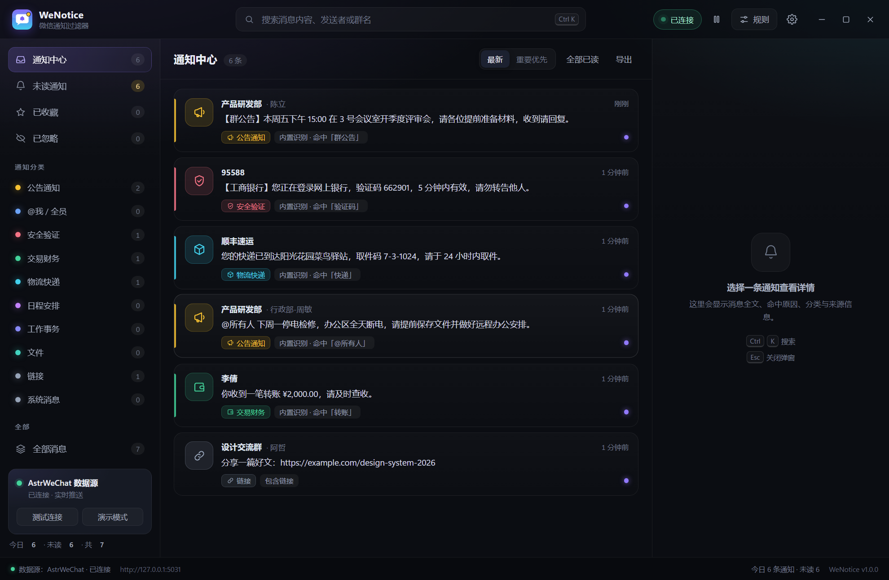
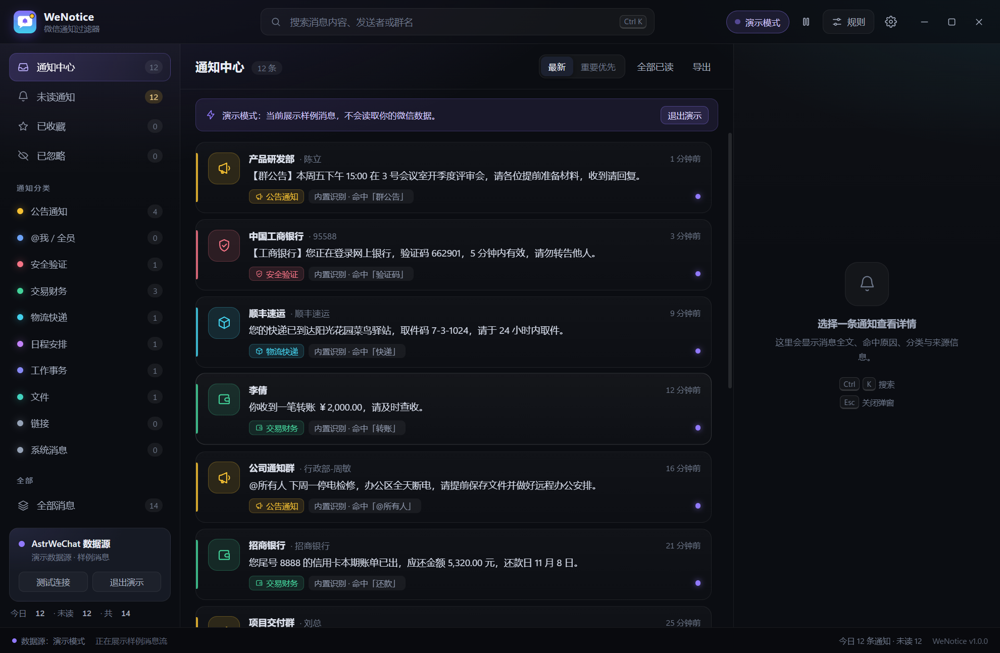
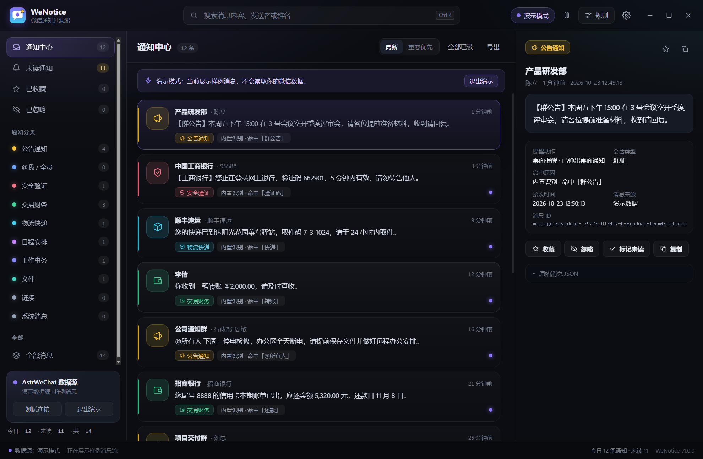
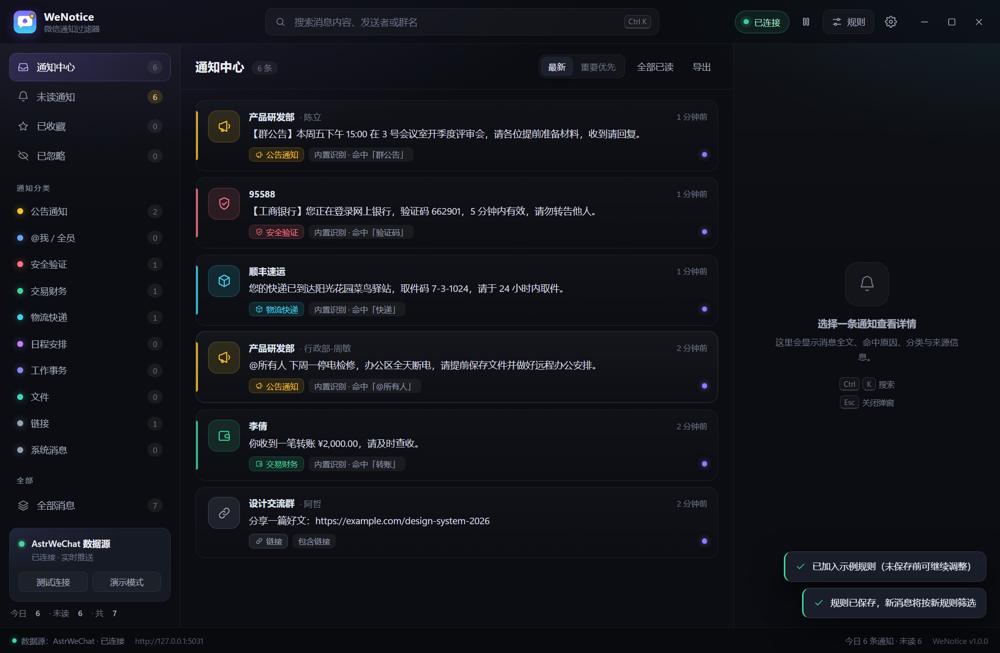
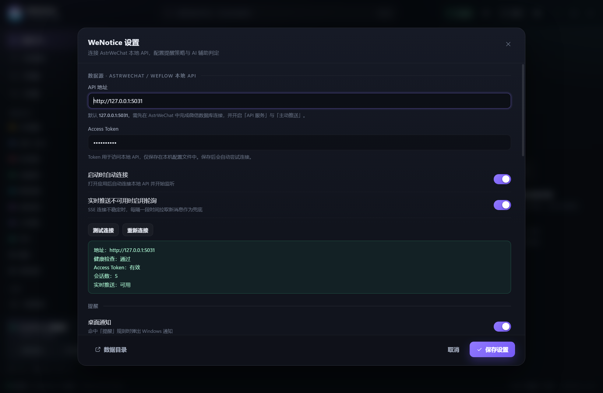

# WeNotice · 微信通知过滤器

> **English summary**: WeNotice is a free, open-source Windows desktop app (MIT, Electron) that
> reads your own WeChat messages from a local API (AstrWeChat/WeFlow, loopback only), classifies
> them with a rule engine, and shows only the important ones (announcements, verification codes,
> payments, deliveries, schedules…) as Windows notifications. No cloud, no telemetry, no data
> collection — see [PRIVACY.md](PRIVACY.md). Windows builds are code-signed via the
> [SignPath Foundation](https://signpath.org) free code-signing program for open-source projects.

> 自动读取本机微信消息，用「内置识别 + 自定义规则」筛出真正值得看一眼的**通知类消息**，
> 只在此时弹出 Windows 桌面通知；广告、闲聊、链接、无效消息全部留在「全部消息」里，不打扰。

[](LICENSE)
[](#)
[](https://www.electronjs.org/)

一个 Windows 桌面应用（Electron，零 npm 依赖），数据源为 **AstrWeChat** 开放的本地 HTTP API（与 WeFlow 同协议）。
所有数据都在本机处理，不经过任何云端。

- 开源地址：<https://github.com/Liuyeyuyangy0/WeNotice>
- 下载：<https://github.com/Liuyeyuyangy0/WeNotice/releases/latest>（便携版 zip，解压即用，无需安装）
- 代码签名：Windows 构建由 **SignPath Foundation**（<https://signpath.org>）提供的免费开源代码签名服务签名（项目已提交申请）
- 协议：MIT（AstrWeChat 为独立的 AGPL-3.0 第三方软件，本项目**不捆绑、不分发**它的代码）
- 隐私：本项目不收集任何用户数据，详见 [PRIVACY.md](PRIVACY.md)



---

## 1. 三个候选项目，到底哪个可行？

结论先说：**AstrWeChat 可行，dong9205/wechat_hook 和泛指的 wechat_hook 都不行。**

| 项目 | 工作机制 | 能否「自动获取收到的消息」 | 与你的微信 4.1.15.56 兼容性 | 结论 |
| --- | --- | --- | --- | --- |
| **AstrWeChat**（CMKH1337/Astrwechat） | 读取微信本地 SQLCipher 数据库（WeFlow/wcdb_api.dll 内核解密，**不注入、不 hook 进程**），Electron 桌面端 + 本地 HTTP API + SSE 主动推送 | **可以**：`/api/v1/push/messages` 实时推送，`/api/v1/messages` 拉历史 | 支持 4.x（社区反馈 4.1.7.33 可用；**4.1.15.56 尚未实测**，需装一次验证） | ✅ 选它 |
| **dong9205/wechat_hook** | Go + openwechat 网页版微信协议，Docker 部署，终端打印二维码登录 | **不能**：源码只有 `POST /api/push/msg` 发送接口，无接收回调（唯一的「接收」是收到 ping 回 pong） | 网页版微信协议 2026 年对新号基本封禁，扫码大概率失败 | ❌ 不可行 |
| **泛称 wechat_hook**（GitHub 上 135 个同名/近名库，通常指 aixed/WeChat-Hook） | DLL 注入微信客户端（version.dll 等），Hook 内存收消息 | 理论可以，但需要**精确匹配微信版本**：WeChatFerry 已归档（止于 3.9.12.51）、daenmax 免费版仅 3.9.10.16、wxhelper 仅 3.9.5.81；aixed 标称 4.1.10.27 但只公开了发送接口，4.x 收消息未确认 | **4.1.15.56 基本不支持**；且注入方案封号风险、维护风险都高 | ❌ 不可行 |

另外两条被评估后排除的路线：

- **官方 ClawBot / iLink**（2026-03 腾讯推出的个人号 Bot 能力）：语义是「Bot 对话」，Bot 只能收到发给它的消息，**读不到你全部收件**，不适合做「筛选我收到的所有消息」。
- **UI 自动化**（如 wechatauto-replica，零注入）：可行但需要窗口可见/轮询，延迟高、体验差，作为 AstrWeChat 不可用时的备选。

> ⚠️ 合规提醒：微信官方明确反对第三方读取聊天数据（chatlog 项目已因律师函于 2025-10 删除代码）。
> AstrWeChat 为 AGPL-3.0 第三方软件，AstrWeChat 及 WeNotice 均只适合**本机个人自用/学习研究**，请勿分发、请勿用于商业或营销场景，账号风险需自行承担。

---

## 2. 它是怎么工作的

```
┌───────────────┐   本地 SQLCipher 解密    ┌──────────────────────┐
│  Windows 微信  │ ───────────────────────▶ │ AstrWeChat（第三方）   │
│  4.x 客户端    │   （WeFlow/wcdb 内核）     │  本地 HTTP API :5031   │
└───────────────┘                          └──────────┬───────────┘
                                                      │ SSE 实时推送
                                                      │ /api/v1/push/messages
                                      ┌───────────────▼───────────┐
                                      │  WeNotice（本项目）        │
                                      │  · 数据源适配 + 断线重连    │
                                      │  · 内置识别 + 自定义规则    │
                                      │  · 桌面通知（去重/免打扰）  │
                                      │  · 通知中心 UI / 托盘      │
                                      └───────────────────────────┘
```

- 消息先经过**规则引擎**：`系统事件 → 自己发送 → 静音会话 → 用户规则（按优先级）→ 重点会话 → 内置词库识别`
- 判定结果三档：`notify`（弹桌面通知 + 进通知中心）、`list`（只进通知中心）、`ignore`（只在「全部消息」）
- 内置识别覆盖 12 类：公告通知、@我/全员、安全验证、交易财务、物流快递、日程安排、工作事务、文件、链接、系统消息、普通聊天、自定义
- **可选：QQ 消息源（WeNotice v1.3.1+）**——WeNotice 作为 OneBot 11 WebSocket **客户端**，连接本机 QQ 协议端（推荐 [NapCatQQ](https://github.com/NapNeko/NapCatQQ)）只读接收 QQ 群/私聊消息，与微信消息共用同一套分类、规则、通知、托盘；WeNotice 不实现 QQ 登录协议、不向 QQ 发送任何消息。

---

## 3. 快速开始

### 方式 A：直接用便携版（推荐给最终用户）

```
dist\WeNotice\WeNotice.exe
```

> 仓库里不含打包产物（dist/ 与 Electron 运行时都不入库）。从源码构建见「方式 B + 打包便携版」；
> 也可以直接下载 Releases 里的 `WeNotice-portable-*.zip`，解压后双击 `WeNotice.exe`。

双击即可运行，无需安装 Node/编译环境。首次启动是**演示模式**（内置 24 条样例消息，不读取你的微信数据），
可以先体验界面与筛选效果；配置好数据源后关闭演示模式即可接入真实消息。

> **自动拉起 AstrWeChat**：关闭演示模式后，WeNotice 每次启动都会检测 `127.0.0.1:5031` 的本地 API——如果 AstrWeChat 没在运行，会按安装路径自动拉起它（注册表卸载信息 → 常见安装目录 → `where.exe` 查找），然后等待 API 就绪并自动连接。AstrWeChat 冷启动通常需要 15–25 秒，期间状态栏会显示「正在启动 AstrWeChat…」。可在 设置 → 数据源 中关闭「自动启动 AstrWeChat」或手动指定 `AstrWeChat.exe` 路径。

> `WeNotice.exe` 只是一个轻量启动器（约 38KB），真正运行的是同目录下的 `electron.exe`——Electron 在部分 Windows 环境下重命名后可执行文件会启动崩溃，所以保持原名。**分发时请整个 `WeNotice` 文件夹一起拷贝**，不要只拿 `WeNotice.exe`，也不要手动给 `electron.exe` 改名。
>
> 启动器会先按正常方式启动；若所在环境限制了 Chromium 沙箱（企业终端、远程会话、受管主机等）导致 electron 秒退，会自动追加 `--no-sandbox` 重试一次，保证应用能打开。
>
> ⚠️ **安装位置很重要**：请把整个 `WeNotice` 文件夹放在**普通用户目录**运行，例如
> `%LOCALAPPDATA%\Programs\WeNotice` 或 `C:\Users\<用户名>\WeNotice`。
> 放在 AI 代理工作区、同步盘、受控企业目录等「受限目录」里运行时，Windows 会拒绝对该进程的托盘注册
> （`Shell_NotifyIcon` 返回 ACCESS_DENIED），表现为**托盘没有图标**——这是环境限制，不是应用缺陷。
> v1.1.1 起启动器会**在创建托盘前先探测**：受限目录下会立刻弹窗提示原因并给出迁移方法，不再静默丢图标。
> 本机已验证：同一份程序放在代理工作区内托盘不显示，移到 `C:\Users\<用户名>\WeNotice` 后图标正常。
> 另外，v1.1.1 起重复双击启动会提示「WeNotice 已经在运行」，而不是静默退出——按 `Ctrl+Alt+Shift+W` 即可找回窗口。



用户数据目录：便携版为 `<WeNotice目录>\resources\.data\data\`（跟着文件夹走，可整体拷贝）；
以 asar 安装包运行时为 `%APPDATA%\WeNotice\data\`。

### 方式 B：开发模式（改代码时）

```powershell
# 1) 首次准备 Electron 运行时（约 150MB，从 npmmirror 下载，不走 npm）
node tools\download-electron.mjs 45.0.0 tools\electron-v45.0.0-win32-x64.zip
tar -xf tools\electron-v45.0.0-win32-x64.zip -C tools\electron-dist

# 2) 运行（--demo 表示用内置样例数据，不读微信）
$env:ELECTRON_RUN_AS_NODE = $null
.\tools\electron-dist\electron.exe .\app --demo
```

- `--demo`：强制演示模式
- `--no-demo`：强制真实数据源（按 config.json）
- `--shot=build/shot.png --shot-delay=7000`：截屏后退出（开发调试用）
- `--select=1`：自动选中第一条消息；`--page=settings|rules`：启动后自动打开对应弹窗

---

## 4. 接入真实微信（AstrWeChat 步骤）

1. **退出微信登录**（托盘右键 → 退出登录，仅关窗口不算）。AstrWeChat 的密钥获取要求微信处于未登录状态。
2. 安装 AstrWeChat（GitHub Releases 下载 `AstrWeChat-1.5.0-Setup.exe`，约 123MB，需管理员权限）。
3. 打开 AstrWeChat → 左侧「微信连接」：点「自动检测」→ 点「自动获取」（等它提示后**再登录微信**），
   拿到密钥后检查数据目录/微信 ID，点「连接数据库」，能看到会话列表即成功。若已有密钥可手动填写。
4. **开启 AstrWeChat 本地 API**（AstrWeChat 1.5.0 没有独立的「设置 → API 服务」页）：
   - 推荐：打开 WeNotice → 设置 → 数据源 → 点 **「一键开启 AstrWeChat API」**，它会自动写入 AstrWeChat 配置（开启 API 服务 + 主动推送）并重启 AstrWeChat，然后自动读取 Token；
   - 手动：AstrWeChat → 左侧 **「Bridge」页** → 点「启动 AstrWeChat / 保存并启动」，该流程会一并开启 API 服务与主动推送并生成 Access Token（端口默认 `http://127.0.0.1:5031`）。
   > Token 不需要手动复制：WeNotice 默认会自动读取 `%APPDATA%\weflow\WeFlow-config.json` 里的 `httpApiToken`。该字段可能是 AstrWeChat 用系统加密保存的 `safe:...` 形式，WeNotice 会先解密再使用，并在写入前用 `/api/v1/sessions` 校验，避免覆盖能用 Token。解密失败时会给出提示，此时点「一键开启 AstrWeChat API」即可自动修复。
5. 打开 WeNotice（会自动拉起并等待 AstrWeChat 的 API）→ 右上角齿轮「设置」→ 数据源：
   - API 地址：`http://127.0.0.1:5031`
   - Access Token：点「自动读取」（或粘贴 Token）
   - 点「测试连接」应看到：健康检查 通过 / Token 有效 / 微信连接 正常 / 会话数 > 0 / 实时推送 可用
   - 保存设置，并在侧边栏关闭演示模式（或点「退出演示」）
6. 之后新消息会实时出现在通知中心，命中「提醒」级规则的才会弹 Windows 通知。
   应用首次连上时还会**自动回填最近 12 小时**的消息（只进列表、不弹通知），方便立刻看到历史通知；
   可在 设置 → 数据源 里关闭回填或调整时间范围。

> 若 AstrWeChat 只开了 API 但没开「主动推送」，WeNotice 会在两次失败后自动降级为会话轮询（默认 25s），
> 不等实时，但至少不漏。

> **让 AI Agent 帮你配置？** 见 [`docs/AGENT-SETUP.md`](docs/AGENT-SETUP.md)：里面写清了 Agent 可以自动做哪些步骤、
> 哪些必须由人工完成（取密钥、扫码登录、设口令），以及每步的只读校验命令、常见故障速查和回执模板。

---

## 4.1 接入 QQ（可选，OneBot 11）

WeNotice 不实现 QQ 登录协议，而是作为 **OneBot 11 WebSocket 客户端**，连接本机运行的 QQ 协议端**只读接收**消息（不发消息，不用 QQ 账号跑机器人指令）。推荐协议端：[NapCatQQ](https://github.com/NapNeko/NapCatQQ)（基于 NTQQ，活跃维护，自带 OneBot 11 WebSocket 服务端）。

### 4.1.1 一键安装（推荐，Windows）

仓库自带 `tools\setup-napcat.ps1`，把便携 QQ + NapCat + 注入器 + 启动脚本一次性配好，避开常见坑（NapCat 包被截断、bat 换行符错误、注入器版本不匹配、QQ 报「文件已损坏」等）：

```powershell
# 联网一键安装（默认装到 %USERPROFILE%\NapCat，自动下载 QQ 与 NapCat）
pwsh -File tools\setup-napcat.ps1

# 已有本地安装包时（离线/复用，避免重复下载 300MB+）
pwsh -File tools\setup-napcat.ps1 -QQInstaller .\QQ.exe -NapCatZip .\NapCat.Shell.zip -SevenZip .\7z.exe

# 只修复已有安装（重写 bat、同步注入器、修复 package.json、写 WebUI 配置）
pwsh -File tools\setup-napcat.ps1 -InstallDir C:\Users\<你>\NapCat -Repair
```

脚本会生成 `napcat.bat`（自动请求管理员权限）和桌面快捷方式「启动 NapCat（管理员）」；双击后扫码登录，按提示在 NapCat WebUI 添加 WebSocket 服务器 `127.0.0.1:3001`，然后回到 WeNotice 开启 QQ 数据源即可。**不需要每次重装**，之后重新登录只需双击快捷方式（或用 `napcat.quick.bat` 快速登录）。

> 注意：NapCat 是协议端登录，**同一 QQ 账号登录后，电脑端 QQ 会被挤下线**（与微信协议登录一样）。WeNotice 读取微信之所以不掉线，是因为 AstrWeChat 走的是「本地数据库解密」而不是登录协议。建议用一个小号专门跑 NapCat，或关注后续实验性的「QQ 本地数据库只读」数据源（不登录、只读本机记录，见 4.1.2）。

### 4.1.2 手动安装（可选）

1. 安装并登录 NapCatQQ（它基于 Windows QQNT 客户端；按 NapCat 官方文档安装/启动，首次扫码登录）。
2. 在 NapCat 里开启 **「WebSocket 服务器」**（NapCat WebUI → 网络配置 → 添加 WebSocket 服务器），默认地址 `ws://127.0.0.1:3001`；如果设置了 Token，记下来。
3. 打开 WeNotice → 设置 → 「QQ 数据源 · OneBot 11」→ 打开「启用 QQ 消息接收」→ 填 OneBot WebSocket 地址（默认 `ws://127.0.0.1:3001`）和 Token（如有）→ 点「测试连接」。
4. 连接成功后，侧边栏会出现「QQ 数据源 · OneBot / 已连接 · QQ号」，QQ 群公告、验证码、快递等消息会和微信消息一起进入通知中心、按同一套规则分类与提醒。
5. 也可在设置里关闭「启动时自动连接 QQ」或整个 QQ 数据源——只想要微信时不影响原有使用。

> 安全与合规：WeNotice 只作为 WebSocket 客户端读取 OneBot 事件，**不会向 QQ 发送消息**。QQ 协议端本身属于第三方非官方实现，存在账号风控风险，请自行评估；WeNotice 的 MIT 发布包不包含任何 QQ 协议端代码。

---

## 5. 功能清单

- **通知中心**：通知中心 / 未读 / 收藏 / 已忽略 / 按 12 类分类计数 / 全部消息；搜索（Ctrl+K）、最新/重要优先排序、全部已读、导出 JSON
- **详情面板**：分类、会话、发送者、命中原因、AI 摘要、原始 JSON、收藏/忽略/标记已读/复制
- **规则引擎**：内置 12 类词库 + 5 个一键示例模板；自定义规则支持关键词/正则/发送者/会话/范围（全部、群聊、私聊、公众号、服务号）与 5 种动作（桌面提醒、只列表、忽略、收藏、必须提醒）
- **通知策略**：免打扰时段（支持跨零点）、同会话合并窗口、每分钟频率上限、仅重要分类、提示音、通知点击直达消息并自动标记已读
- **日程闹钟**：自动识别通知里的时间（`明天下午3点`、`本周五 15:00`、`11月1日 19:30` 等）并在到点时提醒；侧栏「日程闹钟」统一管理（稍后提醒 / 完成 / 删除）；消息详情可手动「设为闹钟」；历史回填消息不触发闹钟，可在设置关闭自动识别
- **首次使用向导**：首次启动引导「演示体验 → 连接 AstrWeChat → 开启 API → 测试连接」，可从 设置 → 应用 → 新手引导 再次打开
- **一键开启 AstrWeChat API**：设置 → 数据源 点一下，自动写入 AstrWeChat 配置（开启 API 服务 + 主动推送）并重启它，再自动读取 Token——不用再找 AstrWeChat 里藏起来的开关
- **Token 自动读取**：连接前自动从 `%APPDATA%\weflow\WeFlow-config.json` 读取 AstrWeChat 的 API Token（包含 `safe:` 系统加密形式会自动解密，且先用 `/api/v1/sessions` 校验有效才写入），AstrWeChat 重启换 Token 也无需手动复制（设置里可关闭或手动覆盖）
- **规则导入 / 导出**：规则弹窗底部支持 JSON 导入导出，方便备份、迁移和分享规则
- **诊断导出**：设置 → 应用 → 导出诊断信息，生成脱敏的配置 + 启动日志，反馈问题时直接附带
- **托盘常驻**：关闭窗口按设置隐藏到托盘；托盘菜单显示未读数/连接状态，可暂停提醒、切换演示、退出
- **启动器托管托盘**：便携版的托盘图标由 `WeNotice.exe` 启动器（原生 WinForms）显示——部分 Windows 环境下 Electron 自带托盘不显示，改成启动器托管更稳；应用通过本地回环控制接口（随机端口 + 随机 Token，写入 `resources\.data\control.json`）与启动器通信
- **全局快捷键**：无论窗口最小化还是隐藏到托盘，按 `Ctrl+Alt+Shift+W`（备用 `Ctrl+Alt+F9`） 都能把 WeNotice 找回（托盘不可见时的兜底）
- **最小化到托盘**：点标题栏「—」默认隐藏到系统托盘而不是任务栏（设置 → 应用可关）；首次最小化会弹出气泡提示图标位置，托盘图标单击/双击都能恢复窗口
- **数据源健壮性**：SSE 断线指数退避重连、心跳看门狗、401/403 Token 失效提示、轮询回退
- **QQ 消息源（可选，OneBot 11）**：作为 WebSocket 客户端连接本机 NapCatQQ 等 OneBot 11 协议端，只读接收 QQ 群/私聊消息，与微信消息统一分类、规则、通知、托盘与快捷键；连接状态显示「QQ 已连接 · QQ号」；可在设置里单独启停或配置地址/Token
- **自动拉起 AstrWeChat**：启动时检测本地 API，未运行时自动定位并拉起 AstrWeChat、等待 API 就绪后再连接；可在设置中关闭或手动指定路径
- **连接后回填**：连上数据源时自动补齐最近 12 小时消息（可关闭），避免刚打开时列表空白；回填消息带「回填」标记、不弹桌面通知、不计入未读
- **内容清洗**：公众号文章/小程序/文件等 XML 消息自动提取标题与摘要，不再显示原始 XML；公众号普通推文默认只归档不打扰，标题命中关键词才进列表/提醒
- **AI 辅助判定**（可选）：OpenAI 兼容接口，对「拿不准」的消息二次判定并给出摘要，失败自动降级为纯规则
- **演示模式**：无微信/无 AstrWeChat 时也能完整跑通筛选与通知链路

---

## 6. 数据与隐私

- 消息只在本机内存与 `data\history.json` 中保存（默认上限 2000 条）。数据目录：便携版为 `<WeNotice目录>\resources\.data\data`（跟随文件夹走，可整体拷贝）；以 asar 安装包运行时为 `%APPDATA%\WeNotice\data`
- Access Token 仅写入本机 config.json（明文，与他人共用电脑时请注意）
- 不访问任何远程服务；AI 功能仅在你主动启用并填写自己的 API Key 时，才会把「待判定消息文本」发到你所配置的接口
- 应用不做任何网络代理、不上传通讯录/朋友圈数据

---

## 7. 已知限制与风险

- **AstrWeChat 是单人维护的 AGPL-3.0 项目**，本机（Windows 微信 4.1.15.56 + AstrWeChat 1.5.0）已实测跑通；但微信升级可能让读取失效，需等待 AstrWeChat/WeFlow 更新
- **Release 不附带 AstrWeChat 安装包**：AstrWeChat 为 AGPL-3.0 且涉及腾讯/微信数据合规风险，WeNotice 的 MIT 发布包只包含自身代码；请从 [AstrWeChat Releases](https://github.com/CMKH1337/Astrwechat/releases/latest) 自行安装（向导里也有「下载 AstrWeChat」按钮）
- AstrWeChat 取密钥需要微信处于未登录状态；wcdb 原生组件有有效期（旧版本曾出现过期提示，升级 AstrWeChat 即可）
- WeNotice 只负责「读消息 + 筛选 + 通知」，**不支持发送/回复**（AstrWeChat 的发送依赖 UI 自动化，稳定性另说）
- 桌面通知依赖 Windows 通知权限；若系统未开启，应用内仍会收到消息
- 便携版入口是启动器 `WeNotice.exe`（拉起同目录 `electron.exe`），不要重命名 `electron.exe`；否则可能在部分 Windows 环境启动崩溃（已实测）
- **不要把 WeNotice 放在受限目录**（AI 代理工作区、同步盘、受控企业目录等）：Windows 会拒绝对该进程注册托盘图标（`Shell_NotifyIcon` ACCESS_DENIED），表现为托盘无图标。请放到普通用户目录，详见 `docs/TRAY.md`
- 未签名的本地构建首次运行会被 SmartScreen 提示「发布者未知」，这是 Windows 对未知程序的常规拦截，不是应用行为
- 本项目不含微信客户端修改，不注入进程；但第三方读取微信数据本身存在账号风险，请自行判断
- **QQ 数据源依赖第三方协议端**（如 NapCatQQ）：WeNotice 只作为 OneBot 11 WebSocket 客户端读取事件、不向 QQ 发送消息；QQ 协议端本身属于非官方实现，存在账号风控风险，且不受本项目控制

---

## 8. 常见问题

**Q: 点「一键开启 AstrWeChat API」提示无法关闭 AstrWeChat？**
A: 说明 AstrWeChat 正在以管理员权限运行。任选其一：① 托盘右键退出 AstrWeChat（或任务管理器结束），回到 WeNotice 再点一次；② 设置 → 应用 →「以管理员身份重启」提权重启 WeNotice 后再点。注意：WeNotice 启动时只**读取**已保存的 Token，不会主动改 Token；想换新 Token 请点「一键开启」。

**Q: 日程闹钟是怎么来的？能关吗？**
A: 收到日程类通知（群公告、会议、报名截止等）时，WeNotice 会用本地规则解析其中的时间并自动建闹钟，到点弹窗 + 提示音（可在设置 → 日程闹钟关闭自动识别、改默认提前量）。历史回填的消息不会补建闹钟；任意消息详情里也能手动「设为闹钟」。

**Q：测试连接失败 / 401？** A：确认 AstrWeChat 已启动且 API 服务开启（**注意：AstrWeChat 1.5.0 没有「设置 → API 服务」页，开关在左侧「Bridge」页**）；新版会自动读取 AstrWeChat 配置里的 Token（设置 → 数据源 → 「自动读取 Token」），也可以点输入框旁的「自动读取」按钮手动同步；确认端口 5031 没被占用。如果提示「Token 加密无法解密」，说明 AstrWeChat 用系统加密/口令模式保存了 Token：打开 AstrWeChat → Bridge → 启动 AstrWeChat，再点「自动读取」，或手动复制 Token 粘贴。

**Q：AstrWeChat 里找不到「开启 API / 主动推送」的开关？** A：AstrWeChat 1.5.0 没有独立的 API 设置页，开关藏在左侧 **「Bridge」页**的「启动 AstrWeChat / 保存并启动」流程里：点它会启动本地消息服务、开启 API 服务与主动推送，并生成 Access Token。更省事的办法：WeNotice → 设置 → 数据源 → 点「一键开启 AstrWeChat API」，程序会替你改配置并重启 AstrWeChat。

**Q：第一次打开弹出的「欢迎使用 WeNotice」向导是什么？怎么关掉 / 再打开？** A：这是首次使用向导（演示 → 连接 AstrWeChat → 开启 API → 测试连接），每台电脑只出现一次。点「稍后」会关闭并记住；想再看：设置 → 应用 → 新手引导。

**Q：为什么 release 里不附带 AstrWeChat 安装包？** A：AstrWeChat 使用 AGPL-3.0 且涉及微信数据读取的合规风险，把它打进 WeNotice 的 MIT 发布包既会让许可变复杂，也可能因微信法务问题让整个发布下架（同类项目 chatlog 已因律师函删库）。因此 WeNotice 只在向导里提供官方下载入口，由用户自行安装 AstrWeChat——功能上已经做到「打开 WeNotice 自动检测并拉起 AstrWeChat」，安装只需一次。

**Q：状态显示「连接异常：AstrWeChat 尚未完成微信连接」？** A：说明 API 与 Token 都正常，但 AstrWeChat 还没接上微信数据库。打开 AstrWeChat → 左侧「微信连接」完成「自动检测 → 自动获取密钥（需微信先退出登录）→ 登录微信 → 连接数据库」，然后回 WeNotice 点「重新连接」。侧边栏和空状态页都会给出这条指引。

**Q：打开 WeNotice 后一直显示「正在启动 AstrWeChat…」？** A：AstrWeChat 冷启动一般 15–25 秒；若超过 35 秒仍无响应，多半是 AstrWeChat 启动了但没开启本地 API（去 AstrWeChat → 「Bridge」页 → 启动 AstrWeChat），或安装路径没被自动检测到——可在 设置 → 数据源 里手动指定 `AstrWeChat.exe` 路径。

**Q：连接成功但收不到新消息？** A：检查 AstrWeChat 是否开启「主动推送」；微信是否在登录状态并在收消息；可在 WeNotice 状态栏看是「实时推送」还是「轮询模式」。

**Q：双击 WeNotice.exe 弹出「Windows 已保护你的电脑 / 发布者未知」？** A：这是 SmartScreen 对**未签名新程序**的常规拦截（本地构建的 exe 没有受信任的代码签名），不是应用行为。点「更多信息 → 仍要运行」即可；如果是从网上/聊天软件下载的 zip，先右键 zip 或解压后的文件夹 → 属性 → 勾选「解除锁定」再解压/运行。想让它显示发布者、减少提示，可以用 `tools/sign-exe.ps1` 做本机自签名（只在本机有效）；对外分发建议配置 SignPath 免费开源签名，见 §11。

**Q：点了最小化，窗口不见了、也找不到小图标？** A：先确认 WeNotice **不在受限目录**（AI 代理工作区、同步盘、受控企业目录等）——受限目录下 Windows 会拒绝注册托盘图标，请把整个文件夹移到 `C:\Users\<用户名>\WeNotice` 这类普通用户目录（详见 §3 方式 A 与 `docs/TRAY.md`）。WeNotice 默认「最小化到托盘」，窗口会从任务栏消失。托盘图标由 `WeNotice.exe` 启动器显示，通常位于任务栏右下角的「^」展开区：点「^」→ 找到 WeNotice 图标（悬停会显示「WeNotice · N 条未读」）→ 单击恢复窗口；也可以把它从「^」里拖到任务栏固定。**如果「^」里仍然没有图标**，直接按 `Ctrl+Alt+Shift+W`（备用 `Ctrl+Alt+F9`） 就能把窗口找回——这是专门为此准备的全局快捷键；再次启动 WeNotice 也会恢复已有窗口。首次最小化时应用会弹一条系统气泡提示图标位置。不想用这个行为：设置 → 应用 → 关闭「最小化到托盘」，最小化就会留在任务栏。

**Q：为什么通知中心里有很多「回填」消息？** A：应用连上数据源后会补齐最近 12 小时的记录，方便立即看到历史通知。回填消息不会弹通知、不计入未读；不需要可在 设置 → 数据源 关闭「连接后回填最近消息」。

**Q：为什么公众号文章没有进「通知中心」？** A：公众号普通推文默认只归档（可在「全部消息」里看到），只有标题命中通知/日程/交易等关键词时才会进入通知中心，避免被文章刷屏。想全部收进来，可在「规则」里加一条针对「公众号」范围、动作为「只列表」的规则。

**Q：为什么某些重要消息没弹通知？** A：点开消息详情看「命中原因」；内置识别偏保守（比如链接类默认只列队不提醒），可用「规则」页加一条 must_notify 规则，优先级调小（更优先）。

**Q：AstrWeChat 弹「无法连接 AstrBot，请确认服务已启动、地址及端口正确；5 秒后重试」怎么办？** A：这是 AstrWeChat **Bridge** 的提示，跟 WeNotice 无关——Bridge 页当前后端是「AstrBot」，在连 `ws://127.0.0.1:11229/ws`，本机没装/没启动 AstrBot 就会一直重试。只收通知的话：AstrWeChat → Bridge 页不要启动（或停止）Bridge，用 WeNotice 的「一键开启 AstrWeChat API」开本地 API 即可。要用机器人：装并启动 AstrBot，在 AstrBot 里开 OneBot v11 WebSocket（默认 `127.0.0.1:11229`、路径 `/ws`），把 Bridge 的后端地址/Token 对上；也可在 Bridge 页切到「内置模型」或「KouriChat」。详见 `docs/AGENT-SETUP.md` 6.1。

**Q：会封号吗？** A：WeNotice 不注入微信、不模拟登录，只读 AstrWeChat 解密后的本地数据；风险主要来自 AstrWeChat 读取数据库本身，以及微信对第三方读取的打击态度。

**Q：怎么接 QQ 消息？** A：WeNotice 不自带 QQ 协议，需要先在本机跑一个 OneBot 11 协议端，推荐 NapCatQQ（基于 Windows QQNT）。最省事的做法是用仓库自带的一键脚本 `tools\setup-napcat.ps1`（见 §4.1.1，实测从零安装/修复都能跑通）。手动步骤：装好 NapCat 并扫码登录 → NapCat WebUI 里开启「WebSocket 服务器」（默认 `ws://127.0.0.1:3001`）→ WeNotice 设置 → 「QQ 数据源 · OneBot 11」→ 启用并填地址/Token → 测试连接。详细步骤见 §4.1。WeNotice 只读接收，不会向 QQ 发消息。

**Q：接 QQ 会不会让我的 QQ 掉线？能不能像微信一样不影响正常登录？** A：会。NapCat 属于「协议端登录」——同一个 QQ 账号在 NapCat 登录后，电脑端 QQ 会被挤下线，这是 QQ 协议机制决定的，不是 WeNotice 造成的。微信这边之所以不影响（AstrWeChat 走本地数据库解密，只读文件），是因为微信数据库可以用密钥在本地解密；QQ 也有等价的「本地数据库只读」路线（社区项目如 `qq-win-db-key` / `QQDecrypt` 提供密钥提取与解密脚本），但目前没有成熟的实时 API 服务，而且需要管理员权限、逆向能力和定期适配 QQ 版本，因此 WeNotice 暂未内置。可选做法：①把 NapCat 登录用的 QQ 换成**小号**（推荐，最稳）；②等后续实验性的 QQ 本地数据库只读数据源（不登录、不注入、只读本机记录，代价是延迟和兼容性）。

**Q：NapCat 装起来太麻烦，每次都要重新解压/修 bat？** A：不用。用 `tools\setup-napcat.ps1` 一次装好即可，之后每次只需双击桌面快捷方式「启动 NapCat（管理员）」扫码（或用 `napcat.quick.bat` 快速登录）。脚本会自动处理今天常见的坑：NapCat 包被截断（体积<30MB 会重下）、bat 换行符/编码错误、注入器版本不匹配、QQ 报「文件已损坏」、WebUI 端口与 Token 配置。

**Q：QQ 显示已连接，但收不到消息？** A：①确认 NapCat 的 WebSocket 服务器确实在监听（NapCat 日志里能看到连接）；②确认 QQ 账号在 NapCat 里处于登录状态、并且确实有新消息；③如果 NapCat 配置了 Token，WeNotice 里必须填一样的；④点侧栏 QQ 卡片上的「测试连接」看具体错误；⑤QQ 私聊/群消息都需要 OneBot 端推送 `message` 事件（NapCat 默认会推）。

**Q：微信和 QQ 同时开，会不会互相干扰？** A：不会。两者是独立数据源：任一连接成功就能工作；顶部胶囊与状态栏会显示主数据源（微信优先，微信未配置时显示 QQ）；侧边栏两张数据源卡片分别显示各自状态；消息统一进入同一个通知中心，规则与免打扰等策略共用。

---

## 9. 目录结构与开发

```
WeNotice/
├─ app/                     应用源码（Electron 主进程 + 渲染层，纯原生 JS）
│  ├─ main.js              主进程：窗口/托盘/通知/IPC/消息 ingest
│  ├─ preload.js           contextBridge API
│  ├─ lib/
│  │  ├─ store.js          配置/规则/历史持久化
│  │  ├─ rules.js          规则引擎 + 内置识别 + 示例模板
│  │  ├─ source.js         AstrWeChat/WeFlow HTTP+SSE 数据源适配
│  │  ├─ qqsource.js       QQ 数据源适配（OneBot 11 WebSocket 客户端）
│  │  ├─ astr.js           AstrWeChat 进程检测 / 自动拉起 / API 健康等待
│  │  ├─ content.js        公众号/XML 消息内容清洗
│  │  ├─ ai.js             OpenAI 兼容 AI 二次判定
│  │  └─ demo.js           演示数据源
│  ├─ renderer/            index.html / styles.css / app.js
│  └─ assets/              图标与托盘图标（脚本生成，见 tools/gen-*.py）
├─ tools/
│  ├─ download-electron.mjs  下载 Electron 预编译包（npmmirror）
│  ├─ mock-weflow.mjs        WeFlow/AstrWeChat API 模拟服务（无微信时联调）
│  ├─ mock-onebot.mjs        OneBot 11 WebSocket 模拟服务端（无 QQ 时联调）
│  ├─ setup-napcat.ps1      QQ 数据源一键安装/修复（便携 QQ + NapCat + 注入器 + 启动脚本）
│  ├─ fix-astr-bridge.ps1   AstrWeChat Bridge 的 Python 运行时修复 / 离线依赖包（可选、实验性）
│  ├─ launcher.cs           WeNotice.exe 启动器源码（C#，csc 编译）
│  ├─ build-portable.ps1    便携版打包脚本
│  ├─ gen-icons.py          应用图标生成（Pillow）
│  ├─ gen-tray-icon.py      托盘图标生成（Pillow，高对比度版）
│  ├─ electron-dist/        Electron 运行时（自行下载，不入库）
│  └─ WeNoticeLauncher.exe  启动器编译产物（打包脚本生成，不入库）
├─ docs/screenshots/        界面截图
├─ docs/TRAY.md             托盘图标实现与排障记录（启动器托管托盘、全局快捷键兜底）
├─ docs/AGENT-SETUP.md      给 AI Agent 的自动配置指南（微信源 + QQ 源，含人工确认边界）
├─ dist/WeNotice/           便携版产物（运行 build-portable.ps1 生成，不入库）
├─ build/                   临时构建/截图/测试数据（不入库，可删除）
├─ LICENSE                  MIT
└─ README.md
```

**没有安装 AstrWeChat 时如何联调？**

```powershell
node tools\mock-weflow.mjs 5031 test-token     # 启动模拟 WeFlow API（SSE 推送 7 条样例）
# 另开窗口，写配置（或直接改 %APPDATA%\WeNotice\data\config.json）
# {"source":{"baseUrl":"http://127.0.0.1:5031","token":"test-token","autoConnect":true,"demoMode":false}}
.\tools\electron-dist\electron.exe .\app --no-demo
```

**打包便携版：**

```powershell
powershell -ExecutionPolicy Bypass -File tools\build-portable.ps1
# 产物：dist\WeNotice\WeNotice.exe（启动器）+ electron.exe（运行时），目录整体拷贝即可分发
```

> 打包脚本 6 步：编译 C# 启动器 → 清理 dist → 复制 Electron 运行时（保持 electron.exe 原名）→
> 复制 app 到 `resources\app` → 删除 `default_app.asar` → 写入 `WeNotice.exe`、`version.txt`、`README.md`。

**规则引擎自测：**

```powershell
node build\test-rules.js   # 参考 test-rules.js 的写法
```

---

## 10. 界面截图

| 通知中心 | 消息详情 |
| --- | --- |
|  |  |

| 通知规则 | 设置 |
| --- | --- |
|  |  |

---

## 11. 代码签名（可选）

本项目已向 **SignPath Foundation**（<https://signpath.org>，面向开源项目的免费代码签名计划）提交申请；
获批后，GitHub Actions 构建出的 `WeNotice.exe` 将由 SignPath Foundation 免费签名。

未签名 exe **在本机运行一般不会弹 SmartScreen**（SmartScreen 主要针对从网络下载、带 Mark-of-the-Web 标记的文件）。签名有两种用途：

- **本地自用**：自签名证书只在本机（导入了根证书的机器）显示发布者名，**不改变 SmartScreen 行为**。自签名 = 对 SmartScreen 而言等同于未签名。
- **对外分发**：需要受信任的代码签名证书（商业 OV/EV、[SignPath 开源赞助](https://signpath.org/)、Azure 工件签名）。新证书首发仍可能弹 SmartScreen，需靠下载量积累信誉；**EV 已不再豁免 SmartScreen**（见[微软文档](https://learn.microsoft.com/zh-cn/windows/apps/package-and-deploy/smartscreen-reputation)）。

自签名示例（Windows SDK 自带 signtool）：

```powershell
# 1) 创建自签名证书（5 年，存到 CurrentUser\My）
$cert = New-SelfSignedCertificate -Type CodeSigningCert -Subject "CN=WeNotice" `
  -KeyAlgorithm RSA -KeyLength 3072 -HashAlgorithm SHA256 `
  -CertStoreLocation "Cert:\CurrentUser\My" -NotAfter (Get-Date).AddYears(5)

# 2) 导入到「受信任的根证书颁发机构」和「受信任的发布者」（本机信任，仅测试用）
foreach ($n in 'Root','TrustedPublisher') {
  $s = New-Object System.Security.Cryptography.X509Certificates.X509Store($n,'CurrentUser')
  $s.Open('ReadWrite'); $s.Add($cert); $s.Close()
}

# 3) 用脚本签名并验证（证书库里按 Subject 查找）
powershell -ExecutionPolicy Bypass -File tools\sign-exe.ps1 -File dist\WeNotice\WeNotice.exe

# 或用 .pfx 文件（正式流程）
powershell -ExecutionPolicy Bypass -File tools\sign-exe.ps1 -File dist\WeNotice\WeNotice.exe `
  -Pfx C:\path\cert.pfx -PfxPassword 你的密码
```

> 注意：网上教程里 `signtool sign ... /p <密码>` 的尖括号只是占位符，直接在 PowerShell 里输入会报
> `"<"运算符是为将来使用而保留的`；请替换成真实密码，或直接用本仓库的 `tools\sign-exe.ps1` 参数传入。

### 自动签名（CI，推荐对外分发用）

本仓库提供 GitHub Actions 流水线 `.github/workflows/release.yml`：

- 打 tag 推送到 GitHub 后自动构建便携版并创建 Release（附 `.sha256` 校验文件）；
- 如果仓库配置了 **SignPath Foundation 免费开源签名**（见 [docs/SIGNPATH-APPLICATION.md](docs/SIGNPATH-APPLICATION.md)），
  构建流程会自动给 `WeNotice.exe` 签上受信任的证书；没配置则跳过签名，照常出包。

申请 SignPath 免费签名的完整步骤（填写什么、SignPath 后台怎么配、GitHub 变量/密钥怎么设）都在
[docs/SIGNPATH-APPLICATION.md](docs/SIGNPATH-APPLICATION.md)。

---

## 12. 许可

- **WeNotice 本项目：MIT License**（见 [LICENSE](LICENSE)），可自由使用、修改、分发（保留版权声明）。
- 第三方依赖：
  - [AstrWeChat](https://github.com/CMKH1337/Astrwechat)：AGPL-3.0，**独立的第三方软件**，本项目只通过它的本地 HTTP API 读数据，不捆绑、不修改、不分发它的代码；使用者需自行安装并遵守其许可。
  - [WeFlow](https://github.com/hicccc77/WeFlow)：AstrWeChat 的数据内核来源，许可见其仓库。
  - [Electron](https://www.electronjs.org/)：MIT。
- 合规提醒：微信官方明确反对第三方读取聊天数据（chatlog 项目已因律师函于 2025-10 删除代码）。本项目仅供**本机个人自用/学习研究**，请勿用于商业或营销场景，账号风险需自行承担。


